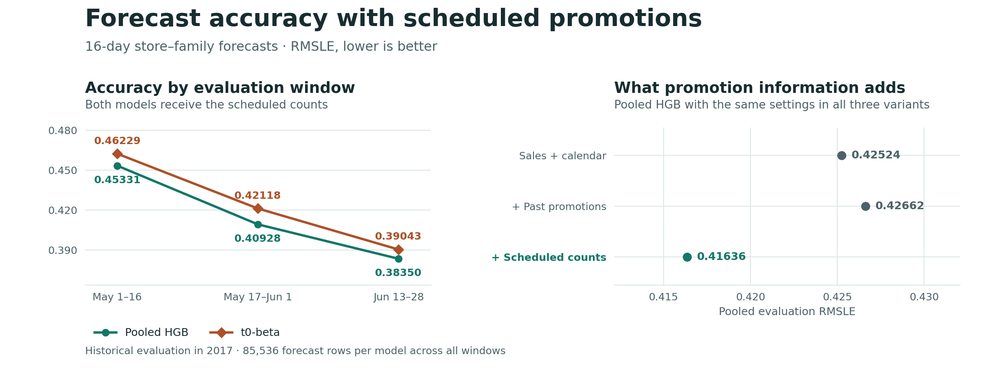

# Forecasting store sales with promotion schedules

**UW ECON 481A · Autumn 2026**

A replenishment planner needs 16 days of forecasts before the next ordering cycle. For Ecuadorian grocer Corporación Favorita, we compare seasonal baselines, independently fitted Prophet models, a pooled gradient-boosted tree, and the pretrained t0-beta time-series model. Within the pooled tree, we test the incremental predictive value of a future promotion schedule after accounting for prior promotions.

[Executed project notebook](project.ipynb) · [Data exploration](#explore-the-data) · [Holiday and payday follow-up](#holiday-and-payday-follow-up) · [Reproduce](#reproduce-the-analysis)

## Findings

The development-selected pooled tree with scheduled promotions had the lowest RMSLE in all three evaluation windows. Its pooled evaluation RMSLE was **0.41636**, about **2.2%** lower than the promotion-aware t0-beta model. t0-beta had the lowest daily MAE and WAPE in each evaluation window. A model can therefore rank first on Kaggle's metric while another produces smaller errors in the units planners order.



| Configuration | Development RMSLE | Evaluation RMSLE | Evaluation MAE |
| --- | ---: | ---: | ---: |
| HGB · past and scheduled promotions | **0.52069** | **0.41636** | 71.06 |
| HGB · sales and calendar | 0.53746 | 0.42524 | 71.26 |
| t0-beta · past and scheduled promotions | 0.52523 | 0.42565 | **66.59** |
| HGB · past promotions only | 0.53844 | 0.42662 | 71.77 |
| Prophet · past and scheduled promotions | 0.67694 | 0.50242 | 128.24 |
| Seasonal naïve | 0.67618 | 0.56105 | 87.68 |
| Eight-week weekday mean | 0.64981 | 0.59415 | 78.42 |

### How the two leading models compare by date

| Forecast dates | HGB RMSLE | t0-beta RMSLE | HGB daily MAE | t0-beta daily MAE |
| --- | ---: | ---: | ---: | ---: |
| May 1–16, 2017 | **0.45331** | 0.46229 | 86.60 | **81.41** |
| May 17–June 1, 2017 | **0.40928** | 0.42118 | 68.82 | **63.02** |
| June 13–28, 2017 | **0.38350** | 0.39043 | 57.78 | **55.36** |

Both models receive the scheduled promotion counts. HGB's pooled lead on RMSLE also varies within the forecast horizon. HGB leads t0-beta at day 1 (**0.43241** versus **0.45279**), and t0-beta leads at day 16 (**0.42498** versus **0.43489**). Each per-day comparison pools the same 5,346 store–family predictions across the evaluation windows. [Overall scores](files/final-results/scores.csv) · [Lead and group scores](files/final-results/slices.csv)

### Where the promotion schedule helps

With the HGB settings fixed, adding the future schedule to past promotions lowered pooled evaluation RMSLE from **0.42662 to 0.41636**. Most of that gain was on promoted store–family–days. The same rows are used on each side of the comparison.

| Rows in the three evaluation windows | Rows | HGB with past promotions | HGB with past and scheduled promotions |
| --- | ---: | ---: | ---: |
| At least one promotion | 40,647 | 0.35778 | **0.33274** |
| Zero promotions | 44,889 | 0.48052 | **0.47966** |

The schedule is most informative for rows where a promotion is planned. Model rankings also depend on the group. t0-beta has a slight edge on promoted rows (**0.33067** versus HGB's **0.33274**), and HGB has a wider edge on unpromoted rows (**0.47966** versus **0.49621**). The comparison assumes planners would have had the recorded future counts at each cutoff. [Calculated promotion slices](files/final-results/slices.csv) · [Full forecast diagnostics](project.ipynb)

## Explore the data

| Item | Coverage |
| --- | --- |
| Forecast unit | Daily sales at one store for one product family |
| Training data | 3,000,888 observations across 54 stores and 33 families from January 2013 to August 2017 |
| Series and dates | 1,782 store–family series and 1,684 recorded dates. The file omits December 25 in 2013–2016 |
| Sales distribution | Median of 11, mean of 357.78, and 90th percentile of 867 sales units per row |
| Zeros and promotions | 31.30% of recorded rows show zero sales. 20.37% show at least one promotion |
| Kaggle test | 28,512 rows for August 16–31, 2017 |

Two patterns motivate the design. Average panel-wide daily sales were about **63% higher on Sundays than on Thursdays**, so weekday baselines are meaningful comparisons. Promotion coverage also changed over time, from **22.6%** in August 2015 to **36.4%** in August 2016 and **42.3%** in July 2017. A single historical window would miss that variation. The notebook charts both patterns. [Competition data](https://www.kaggle.com/competitions/store-sales-time-series-forecasting/data) · [Monthly aggregates](files/data-profile/monthly.csv) · [Weekday aggregates](files/data-profile/weekday.csv)

## How the models were selected

The experiment tunes on six 16-day development windows across 2016–2017, then measures how the selected model transfers to three later 16-day windows. Every model issues the full forecast from the cutoff using up to 512 days of sales history. The pooled model simulates earlier origins whose training labels are already observed. Tests change post-cutoff sales and promotion counts to check that the model sees only the information its variant is allowed to use. [Forecast dates and protocol](files/experiment-plan.md#expanded-evaluation-protocol) · [Run manifest](files/final-results/manifest.json)

The reference HGB settings scored **0.52069** on pooled development RMSLE. A more flexible tree scored **0.52086**, and a more regularized tree scored **0.52324**. The reference won by a small margin, and the experiment holds those settings fixed across the three promotion variants. RMSLE pools the individual squared log errors before taking the square root. MAE counts each absolute unit error directly, while WAPE expresses those errors as a share of recorded sales. [Tuning results](files/final-results/tuning.csv) · [Kaggle metric](https://www.kaggle.com/c/store-sales-time-series-forecasting/overview/evaluation)

## What the forecasts mean for ordering

Aggregating the daily forecasts within each store and product family over 16 days exposes a tradeoff hidden by the overall RMSLE improvement. The table shows the change after adding future promotions to the HGB model that already uses past promotions. A negative value means fewer error units on that side.

| Forecast start | Change in units underforecast | Change in units overforecast |
| --- | ---: | ---: |
| May 1 | −49,553 | +13,723 |
| May 17 | +43,986 | −18,163 |
| June 13 | −35,686 | +8,342 |

Giving an underforecast unit half, equal, or twice the cost of an overforecast unit favored using the schedule in **two of three** windows under each assumption. For an operational test, planners could run both forecasts alongside current orders and record the plan available at each cutoff, stockouts, inventory on hand, and waste. That would show whether smaller forecast errors improve actual ordering outcomes. [Cost sensitivity and Decision Loop](project.ipynb)

## Holiday and payday follow-up

The competition records stores' cities and states, the dates when holidays were actually observed, and a regular public-sector payday schedule. We added holiday indicators, a payday indicator, or both to the same HGB model, holding the 16-day forecast dates, promotion inputs, and model settings fixed. For example, the national holiday nominally on May 24, 2017 is flagged on its observed date, May 26. [Calendar features and assumptions](files/experiment-plan.md#calendar-follow-up) · [Kaggle data documentation](https://www.kaggle.com/competitions/store-sales-time-series-forecasting/data)

| Features added to the reference | Development RMSLE | Evaluation RMSLE |
| --- | ---: | ---: |
| Reference with weekday and month fields | **0.52069** | 0.41636 |
| Local, regional, and national holidays | 0.52137 | 0.41038 |
| Payday on the 15th and at month-end | 0.52199 | 0.41506 |
| Holidays and payday | 0.52162 | **0.40885** |

The combined features improved evaluation RMSLE by **1.8%**, with better results in **two of three** evaluation windows. The holiday-affected rows were **6.5%** of the evaluation panel and accounted for about **64%** of the net reduction in squared log error. Every augmented variant scored worse on pooled development RMSLE. This follow-up reuses historical windows after the main comparison, so the competition export still uses the original development-selected HGB. [Calendar scores](files/calendar-results/scores.csv) · [Holiday and payday slices](files/calendar-results/slices.csv)

## Kaggle submission

The final runner refits HGB with scheduled promotions and exports 28,512 nonnegative predictions aligned to the sample submission IDs. Its submission manifest records the model, test dates, and prediction file hash. An official Kaggle score is pending. [Competition evaluation](https://www.kaggle.com/c/store-sales-time-series-forecasting)

## Reproduce the analysis

### Execute the report and verify the implementation

```bash
conda env create -f environment.yml
conda activate econ481-store-sales
python -m pytest tests
python -m auxiliary.final_experiment --fixture --output-dir results/final-fixture
ECON481_RESULTS=results/final-fixture python -m pytest --nbmake project.ipynb
ECON481_RESULTS=files/final-results python -m pytest --nbmake project.ipynb
```

The report reads one result directory per execution. By default it reads the checked-in aggregate bundle. Set `ECON481_RESULTS` to analyze a rerun. GitHub Actions runs Ruff, Python tests and both notebook executions. The small fixture verifies the pipeline, and saved official aggregates keep the default check independent of competition authentication and checkpoint downloads. [Workflow](.github/workflows/run-notebook.yml)

### Regenerate the official results

Download the [Kaggle archive](https://www.kaggle.com/competitions/store-sales-time-series-forecasting/data) to `data/raw/store-sales-time-series-forecasting.zip`. In the course environment, install the inference dependencies. Linux CPU runners can install `torch==2.15.0` from the [CPU wheel index](https://download.pytorch.org/whl/cpu) first.

```bash
python -m pip install -r requirements-t0.txt
export OMP_NUM_THREADS=4
data=data/raw/store-sales-time-series-forecasting.zip
cache=results/final-model-cache

python -m auxiliary.final_experiment --data "$data" --output-dir "$cache" \
  --model-shard prophet_promotion --jobs 8
python -m auxiliary.final_experiment --data "$data" --output-dir "$cache" \
  --model-shard t0_beta_promotion --device cpu
python -m auxiliary.final_experiment --data "$data" --output-dir results/final \
  --prediction-cache "$cache"
ECON481_RESULTS=results/final python -m pytest --nbmake project.ipynb
python -m auxiliary.final_experiment --data "$data" --output-dir results/kaggle \
  --submission-from results/final/manifest.json
```

The shard commands run the slow models in separate Python processes. The aggregate run validates the cache against the data hashes and cutoff dates before training and comparing the pooled model. With competition access, the optional `full_experiment` GitHub Actions dispatch regenerates the report tables using a repository `KAGGLE_API_TOKEN` secret.

The descriptive tables, homepage figure, and calendar follow-up can be regenerated without rerunning Prophet or t0-beta.

```bash
python -m auxiliary.data_profile --data "$data" --output-dir files/data-profile
python -m auxiliary.plot_evaluation
python -m auxiliary.calendar_experiment --data "$data" \
  --selection-manifest files/final-results/manifest.json --output-dir results/calendar
ECON481_CALENDAR_RESULTS=results/calendar python -m pytest --nbmake project.ipynb
```

## Earlier experiments

The earlier contiguous June–August 2017 comparison and retrospective pooled extension remain available as a record of the project's development. [Original benchmark](files/official-results/scores.csv) · [Pooled model follow-up](files/global-model-comparison.md) · [Earlier dashboard](files/forecast-dashboard.html) · [Earlier report](files/store-sales-research-report.pdf)

The repository follows the [ECON 481A student project template](https://github.com/eisenhauerIO/projects-student-template).
