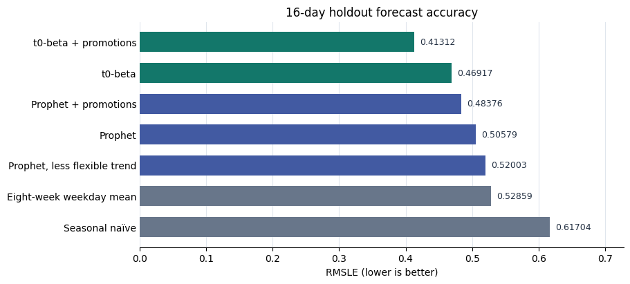
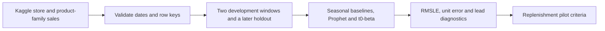

# Store Sales Forecasting

A retail analytics project that compares a time-series foundation model with conventional forecasts to support replenishment planning at Corporación Favorita.

[Research report](files/store-sales-research-report.pdf) · [Interactive dashboard](files/forecast-dashboard.html) · [Executed notebook](project.ipynb) · [Pooled model follow-up](files/global-model-comparison.md) · [Experiment record](files/experiment-plan.md) · [Reproduction](#reproduce-the-analysis)

## Business problem

A grocery retailer needs to plan inventory before the next promotion cycle. A store manager needs to know how much each product family is likely to sell and whether to trust longer-lead forecasts. This project compares forecasts for the next **16 days** across **54 stores** and **33 product families** in Ecuador. It measures the value of supplying a planned promotion schedule when making the forecast. [Kaggle Store Sales](https://www.kaggle.com/competitions/store-sales-time-series-forecasting)

## Results and decision value



| Finding | Evidence from July 31–August 15, 2017 |
| --- | --- |
| Best competition metric | **0.41312 RMSLE** for t0-beta with promotions across 28,512 forecasts |
| Matched model comparison | **14.6% lower RMSLE** than Prophet using the same promotion data. The foundation model led on all 16 holdout forecast leads. |
| Value of promotion counts | Promoted rows made up 43.8% of observations and explained **99.5% of the reduction in squared log error** when t0-beta received promotion counts. |
| Inventory tradeoff | t0-beta with promotions had a lower RMSLE and **0.63 units higher MAE** than history-only t0-beta. A replenishment pilot should evaluate both forecast accuracy and inventory outcomes. |

These are backtests on the labeled competition data. The repository records the archived data checksums and the pinned model checkpoint. [Results by model and window](files/official-results/scores.csv) · [Run manifest](files/official-results/manifest.json)

## Stronger conventional comparison

A pooled gradient-boosting model learns across stores and families. With promotion inputs matched, it led the two pooled development windows at **0.38464 RMSLE** versus **0.38959** for t0-beta. On the later historical window, t0-beta led **0.41312 to 0.41904**, a **1.4%** gap. Its earlier comparison with Prophet gave a **14.6%** gap. The follow-up also separates 16-day underforecasts and overforecasts to show how error direction changes with promotion inputs. [Follow-up report and reproducible results](files/global-model-comparison.md)

## Explore the analysis

The [dashboard file](files/forecast-dashboard.html) lets you switch between validation windows, compare models using RMSLE or MAE, and inspect error by forecast lead. In GitHub, use **Download raw file** on the dashboard file page, then open the downloaded HTML in your browser. It uses the saved aggregate results and runs offline.

The [research report](files/store-sales-research-report.pdf) explains the design, the matched-input comparisons, and how a store could evaluate a replenishment pilot. The [course notebook](project.ipynb) includes the executed analysis, supporting diagnostics, and the Decision Loop.

## Evaluation workflow



The development windows run from June 29 to July 30, 2017. Models forecast each window from a fixed cutoff using earlier sales. Promotion-aware forecasts use the full 16-day schedule as a known input. An operational pilot would need timestamped plans, on-hand inventory, supplier lead times, and the costs of stockouts and excess inventory. [Experiment record](files/experiment-plan.md) · [Course Decision Loop](https://eisenhauerio.github.io/courses-business-decisions/decision-loop/index.html)

## Repository map

| Location | Contents |
| --- | --- |
| [`project.ipynb`](project.ipynb) | Executed course report and reproducible figures |
| [`auxiliary/`](auxiliary/) | Data validation, model implementations, and backtest runner |
| [`files/`](files/) | PDF, offline dashboard, figure, results, and experiment record |
| [`tests/`](tests/) | Date-cutoff, scoring, and row-alignment checks |
| [`environment.yml`](environment.yml) and [workflow](.github/workflows/run-notebook.yml) | Project environment and GitHub Actions checks |

The repository uses the UW ECON 481A student project layout. The [experiment record](files/experiment-plan.md) includes methods, provenance, and academic disclosure. [Official project template](https://github.com/eisenhauerIO/projects-student-template)

## Reproduce the analysis

Use the saved aggregate results to regenerate the report and run the verification checks. The generated fixture exercises the benchmark without opening the competition archive.

```bash
conda env create -f environment.yml
conda activate econ481-store-sales
python -m pytest --nbmake tests project.ipynb
python -m auxiliary.run --fixture --output-dir results/fixture
```

To regenerate the empirical results, download the official data to `data/raw/store-sales-time-series-forecasting.zip` and install the pinned PyTorch runtime. This fits the Prophet models and downloads the frozen t0-beta checkpoint on first use. It produces aggregate scores and optional predictions in `results/official`. [Kaggle data](https://www.kaggle.com/competitions/store-sales-time-series-forecasting/data)

```bash
python -m pip install 'tfc-t0[torch]==0.6.1'
OMP_NUM_THREADS=4 python -m auxiliary.run \
  --data data/raw/store-sales-time-series-forecasting.zip \
  --output-dir results/official --device cpu --jobs 8 --make-submission
```
