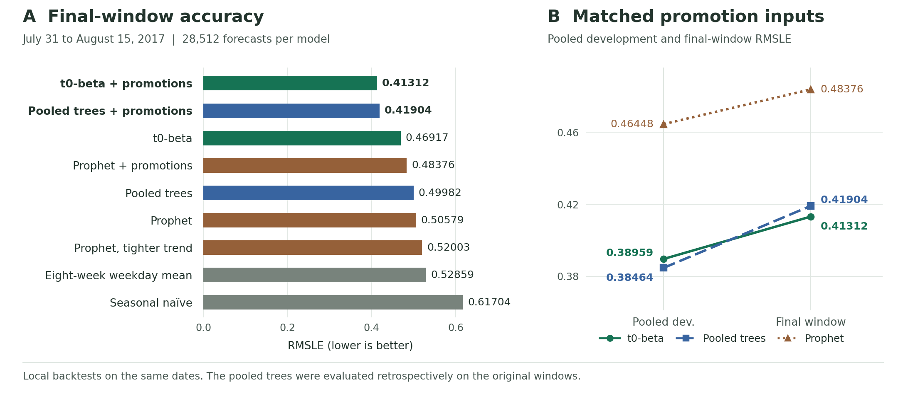

# Store Sales Forecasting

A reproducible retail analytics project on 16-day grocery sales forecasts for Corporación Favorita. It compares seasonal baselines, Prophet, a pooled tree model, and the t0-beta time-series foundation model to help planners decide when to use promotion information.

[Research report](files/store-sales-research-report.pdf) · [Dashboard](files/forecast-dashboard.html) · [Executed notebook](project.ipynb) · [Experiment record](files/experiment-plan.md)

[Models and results](#benchmark-results) · [Promotion and lead-time analysis](#promotion-and-lead-time-analysis) · [Replenishment decision](#replenishment-decision) · [Reproduce](#reproduce-the-analysis)

## What the project found

| Decision question | Evidence from the final historical window |
| --- | --- |
| How much does model choice matter? | t0-beta with promotions scored **0.41312 RMSLE**, 33.0% below seasonal naïve. |
| Does the result hold against a stronger traditional model? | The gap was **14.6%** against Prophet with the same promotion inputs and **1.4%** against pooled gradient boosting with promotions. The pooled tree model led on the two earlier windows combined. |
| Do promotions improve replenishment forecasts? | For the pooled tree model, promotion inputs reduced 16-day underforecasts by about **99,146 units** and increased overforecasts by about **11,652 units** across store–family series. |

## Business problem and data

A replenishment planner needs a forecast before ordering stock for the next promotion cycle. A dependable forecast should handle recurring weekday patterns, products that often sell zero units, and promotions that change demand. The unit of analysis is one **store × product family × date**. [Competition dataset](https://www.kaggle.com/competitions/store-sales-time-series-forecasting/data)

| Data characteristic | Observed coverage |
| --- | --- |
| Labeled sales | **3,000,888** rows from January 1, 2013 through August 15, 2017 |
| Store and product panel | **54** stores × **33** product families = **1,782** daily series |
| Observed dates | **1,684**. Four December 25 dates are absent from the labeled data. |
| Sparsity and promotion | **31.30%** of labeled rows record zero sales, and **20.37%** have a positive promotion count. |
| Competition test file | **28,512** forecast IDs for August 16–31, 2017 |

The loader checks that the composite keys are unique, the panel and test dates are complete where expected, and prediction IDs match the sample submission in order. It preserves gaps on a daily calendar so that a missing date does not shift the weekday pattern. [Data validation](auxiliary/data.py) · [Source-file hashes](files/official-results/manifest.json)

## Evaluation design

~~~mermaid
flowchart LR
    a["Official sales and promotion data"] --> b["Validate dates, keys, and series coverage"]
    b --> c["Build a 16-day forecast at each cutoff"]
    c --> d["Score the same rows for all models"]
    d --> e["Compare forecast error and inventory proxies"]
~~~

| Window | Sales available through | Forecast dates | Evaluation role |
| --- | --- | --- | --- |
| Development 1 | June 28, 2017 | June 29–July 14 | Compare initial candidates |
| Development 2 | July 14, 2017 | July 15–30 | Pool development losses across both windows |
| Final historical window | July 30, 2017 | July 31–August 15 | Assess how the ranking transfers to later dates |

Models forecast all 16 days from the cutoff, using at most **512 calendar days of historical sales**. Promotion-aware variants also use the scheduled counts for forecast dates. The pooled model builds **739,530 training examples per fold** by simulating earlier 16-day forecasts at 15-day intervals. Each training label is observed by the evaluation cutoff. A regression test changes all post-cutoff sales and checks that the generated features and training labels stay identical. The pooled model was introduced after the original historical results were reviewed, making its comparison retrospective. [Experiment design](files/experiment-plan.md) · [Pooled model settings](files/global-comparison/manifest.json) · [Leakage check](tests/test_global_benchmark.py)

## Model design

| Model family | Configurations | What it learns |
| --- | --- | --- |
| Seasonal baselines | Seasonal naïve and eight-week weekday mean | Repeat the last observed same weekday, or average the last eight matching weekdays on the log scale. |
| Prophet | Standard, less flexible trend, and standard with promotions | Fit trend and weekly and annual seasonality separately for each store–family. The more rigid variant tests a lower changepoint prior. |
| Foundation model | t0-beta with and without promotions | Use a pinned pretrained checkpoint to predict each series from its historical context. The project uses the median forecast and leaves model weights frozen. |
| Pooled gradient boosting | With and without promotions | Fit trees across stores and product families using observed sales lags, trailing summaries, identifiers, and calendar predictors. |

The fitted models work on log-transformed sales. Forecasts return to sales units and are constrained to be nonnegative. **RMSLE** is Kaggle's scoring metric. **MAE** measures the average distance from actual sales in unit terms. The development score pools squared log errors across both earlier windows before taking the square root. [Kaggle scoring](https://www.kaggle.com/competitions/store-sales-time-series-forecasting/overview/evaluation) · [Prophet settings](auxiliary/conventional.py) · [t0-beta checkpoint](auxiliary/foundation.py) · [Pooled model](auxiliary/global_benchmark.py)

## Benchmark results

All nine configurations are scored on the same **28,512 rows per window**. Lower values indicate lower error. The table is ordered by final-window RMSLE.

| Configuration | Development 1 RMSLE | Development 2 RMSLE | Pooled development RMSLE | Final RMSLE | Final MAE |
| --- | ---: | ---: | ---: | ---: | ---: |
| t0-beta + promotions | 0.38570 | **0.39344** | 0.38959 | **0.41312** | 71.45 |
| Pooled gradient boosting + promotions | **0.37457** | 0.39446 | **0.38464** | 0.41904 | 76.28 |
| t0-beta | 0.38972 | 0.40355 | 0.39669 | 0.46917 | **70.82** |
| Prophet + promotions | 0.46318 | 0.46576 | 0.46448 | 0.48376 | 108.53 |
| Pooled gradient boosting | 0.38651 | 0.40457 | 0.39564 | 0.49982 | 79.43 |
| Prophet | 0.45849 | 0.47182 | 0.46520 | 0.50579 | 86.32 |
| Prophet, less flexible trend | 0.44321 | 0.48133 | 0.46266 | 0.52003 | 113.68 |
| Eight-week weekday mean | 0.40593 | 0.41697 | 0.41149 | 0.52859 | 82.61 |
| Seasonal naïve | 0.51762 | 0.52117 | 0.51940 | 0.61704 | 96.54 |

**The ranking changes across windows.** Pooled gradient boosting with promotions led the first development window and the two pooled development windows. t0-beta with promotions led the second development window and the later historical window. In that later window, history-only t0-beta achieved the lowest MAE, while t0-beta with promotions achieved the lowest RMSLE. The results support testing both loss measures when the decision is about individual sales units. [Original model scores](files/official-results/scores.csv) · [Pooled model scores](files/global-comparison/scores.csv)

## Promotion and lead-time analysis

| Family | Final RMSLE without → with promotions | Change in daily MAE |
| --- | ---: | ---: |
| Prophet | 0.50579 → 0.48376 | +22.21 units |
| t0-beta | 0.46917 → 0.41312 | +0.63 units |
| Pooled gradient boosting | 0.49982 → 0.41904 | -3.15 units |

**For t0-beta, the largest gains came on promoted rows.** The 12,481 promoted rows were 43.8% of the final window. Their RMSLE fell from **0.48700 to 0.35323**. On the 16,031 remaining rows, it moved from **0.45481 to 0.45430**. Promoted rows accounted for **99.5%** of the net reduction in squared log error from adding the schedule.

**Model choice still mattered at day 16.** t0-beta with promotions had the lowest RMSLE on all 16 leads among the original seven configurations. On day 16, it scored **0.42035**, compared with **0.49141** for history-only t0-beta and **0.54879** for Prophet with promotions. The lead-level breakdown covers the original benchmark. [Forecast-lead and promotion slices](files/official-results/slices.csv)

## Replenishment decision

The following calculation sums forecasts and recorded sales over 16 days for each store–family. It then totals shortfalls and excesses separately across the panel to preserve the direction of the forecast error.

| Pooled tree variant | Underforecast units | Overforecast units | Daily WAPE |
| --- | ---: | ---: | ---: |
| History only | 484,057 | 895,517 | 17.00% |
| With promotion information | 384,911 | 907,169 | 16.33% |

| Decision Loop stage | Proposed evaluation |
| --- | --- |
| Learn | Save the promotion schedule available at each cutoff. Benchmark the current process, weekday mean, pooled trees, and t0-beta on identical dates. |
| Decide | Run forecasts in parallel with the existing ordering process. Track absolute unit errors and underforecasts along with on-shelf availability, waste, and reorder constraints. |
| Repeat | Review results by promotion status and lead time. Continue evaluation on new forecast windows and revisit which forecasts planners should use. |

These directional errors are computed from recorded sales. An operational estimate of stockouts, waste, or profit requires inventory, lead-time, and cost data. [Directional error details](files/global-model-comparison.md#replenishment-implications) · [Course Decision Loop](https://eisenhauerio.github.io/courses-business-decisions/decision-loop/index.html)

## Explore the results

- **Dashboard.** Choose an evaluation window and error metric for the original seven models, then inspect the lead-time plot and promotion breakdown. A separate panel shows the pooled-model follow-up. In GitHub, open the file and select **Download raw file**, then open the HTML in your browser. [Dashboard file](files/forecast-dashboard.html)
- **Research report.** Read the four-page summary of the research question, evaluation design, results, and proposed pilot. [PDF report](files/store-sales-research-report.pdf)
- **Notebook.** Review the executed results, comparison tables, and discussion in the course project format. [Executed notebook](project.ipynb)

## What the evidence supports

| Issue | How it affects interpretation |
| --- | --- |
| Promotion information | The forecasts assume the schedule was available by the cutoff. Historical changes to that schedule are not tracked in the Kaggle files. |
| Forecasting vs. impact | Observed sales can be constrained by available stock. This experiment measures forecast accuracy. The effect of promotions or an ordering policy requires a separate design. |
| Generalization | The data cover one retailer, and the three scoring windows are adjacent. The later pooled-model comparison reuses a reviewed window. |
| External validation | The scores above are local backtests. The unlabeled competition test set requires a separate submission to obtain a Kaggle score. |

## Reproduce the analysis

**Stack:** Python, pandas, NumPy, Prophet, scikit-learn, PyTorch, Jupyter, pytest, and GitHub Actions. The notebook runs from the checked-in aggregate scores. CI checks the code and notebook, including the date cutoff, prediction ID alignment, and the pooled feature leakage test. Model fitting and checkpoint inference can be rerun with the competition data.

~~~bash
conda env create -f environment.yml
conda activate econ481-store-sales
python -m pytest --nbmake tests project.ipynb
python -m auxiliary.run --fixture --output-dir results/fixture
~~~

Download the official archive to `data/raw/store-sales-time-series-forecasting.zip` to regenerate the scores. [Data download](https://www.kaggle.com/competitions/store-sales-time-series-forecasting/data)

~~~bash
python -m pip install 'tfc-t0[torch]==0.6.1'
OMP_NUM_THREADS=4 python -m auxiliary.run \
  --data data/raw/store-sales-time-series-forecasting.zip \
  --output-dir results/official --device cpu --jobs 8

OMP_NUM_THREADS=4 python -m auxiliary.global_benchmark \
  --data data/raw/store-sales-time-series-forecasting.zip \
  --output-dir results/global-comparison
~~~

## Repository map

| Location | Contents |
| --- | --- |
| [`project.ipynb`](project.ipynb) | Executed course report |
| [`auxiliary/`](auxiliary/) | Panel loader, the four model families, and two experiment runners |
| [`files/official-results/`](files/official-results/) and [`files/global-comparison/`](files/global-comparison/) | Aggregate scores, diagnostics where available, and run manifests |
| [`files/experiment-plan.md`](files/experiment-plan.md) | Experimental design, provenance, and academic disclosure |
| [`tests/`](tests/), [environment](environment.yml), and [workflow](.github/workflows/run-notebook.yml) | Verification and reproducibility |

UW ECON 481A · Autumn 2026. [Official student project template](https://github.com/eisenhauerIO/projects-student-template)
